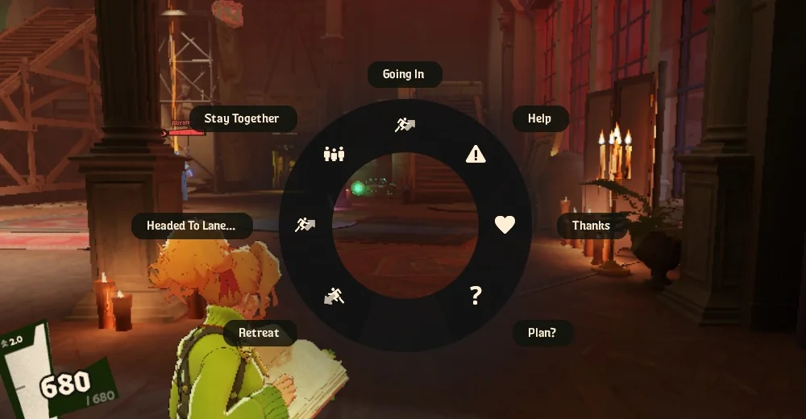

import Interface from '../../../components/Interface.astro';

Deadlock é um jogo de time, e um time que conversa ganha mais. Mas **você não precisa falar no microfone**: o jogo tem um sistema de **pings** que avisa o time com um clique. Quando você manda um ping, o seu herói fala a frase em voz alta e ela aparece escrita na tela de todo o time.

## O ping rápido

Clique com a **rodinha do mouse** (o botão do meio) no que você está mirando. O ping muda conforme o que está na mira:

- **Num lugar do mapa:** marca o lugar com uma seta verde, avisando que você está indo para lá.
- **Num inimigo:** marca o inimigo em **vermelho** para você e para os seus aliados.
- **Num aliado:** avisa que ele está **em perigo**.

Esse é o ping que você mais vai usar. Viu um inimigo indo para a lane de um aliado? Mire nele e clique na rodinha.

## A roda de mensagens

**Segure** a rodinha do mouse e aparece uma **roda com várias mensagens**. Arraste o mouse até a mensagem e solte.

As mensagens padrão são:

| Mensagem | O que quer dizer |
| --- | --- |
| **Going In** | "Vou entrar!" Você vai começar uma luta |
| **Help** | Pedir ajuda |
| **Thanks** | Agradecer a um colega |
| **Plan?** | Perguntar qual é o plano |
| **Retreat** | "Recuem!" O time deve se afastar |
| **Headed To Lane...** | Avisar para qual lane você está indo |
| **Stay Together** | Pedir para o time ficar junto |

Uma das opções é a **mensagem de contexto**: ela muda sozinha conforme a situação. Se você estiver carregando a Soul Urn, por exemplo, ela vira um pedido de ajuda para entregar a Urn. Ela também serve para responder ao ping de um colega.

Dá para escolher quais mensagens aparecem na roda nas configurações do jogo.

## Pings pelo mapa e pelos retratos

Segurando <kbd>Tab</kbd>, você pode mandar pings sem precisar mirar em nada:

- **Clique no minimapa** com o botão esquerdo para marcar um lugar.
- **Clique no ícone de um inimigo** no minimapa para marcar esse inimigo.
- **Clique com a rodinha no retrato de um inimigo**, lá no topo da tela, para avisar que ele **sumiu**. Esse aviso é muito importante: um inimigo que sumiu do mapa pode estar indo pegar alguém de surpresa.
- **Clique com a rodinha no retrato de um aliado** para avisar que ele está em perigo.

Também dá para **desenhar no minimapa**: segure <kbd>Alt</kbd> e arraste com o botão esquerdo em cima do minimapa. O desenho aparece para todo o time e some depois de alguns segundos. É ótimo para mostrar um caminho ou circular um lugar.

## Pings de habilidades e itens

Também dá para mandar ping nas suas **habilidades** e nos seus **itens**. No ping de habilidade aparece quanto tempo falta para ela recarregar. Isso ajuda a combinar uma luta: "minha ultimate está pronta" ou "faltam 20 segundos". No ping de item, você avisa que vai comprar aquele item ou que já tem ele.

## Os pings aparecem como mensagens

Todo ping aparece escrito na tela, com o retrato de quem mandou. É assim que você recebe os pedidos dos seus colegas, como este "Push the York Walker" ("vamos empurrar até o Walker da York"), que já apareceu em *Controles e interface*:

<Interface destaque="objetivo" legenda="Um pedido de um colega de time" />

## Chat de texto e voz

- **Chat de texto:** <kbd>Enter</kbd> abre o chat do time e <kbd>Shift</kbd> + <kbd>Enter</kbd> abre o chat para todos, incluindo os inimigos.
- **Voz:** o chat de voz é opcional. Antes da partida o jogo pergunta se você quer usar, e dá para mudar depois no menu do <kbd>Esc</kbd>. Para falar, segure <kbd>T</kbd>.
- **Silenciar alguém:** se alguém estiver sendo chato, você pode silenciar essa pessoa pelo menu do <kbd>Esc</kbd>. Ela não fica sabendo, e o silêncio continua valendo nas próximas partidas.

## Boas práticas

- **Avise quando um inimigo sumir.** É o aviso mais útil de todos, e quase ninguém faz.
- **Mande um ping antes de ir.** Se você vai atacar um objetivo ou mudar de lane, avise primeiro. O time não lê pensamentos.
- **Não exagere.** Muitos pings seguidos viram barulho, e o time para de prestar atenção.
- **Responda aos pedidos.** Se não puder ajudar, use a roda de mensagens para avisar.
- **Silencie sem dó.** Se alguém estiver estragando a sua diversão, silencie e siga jogando.
