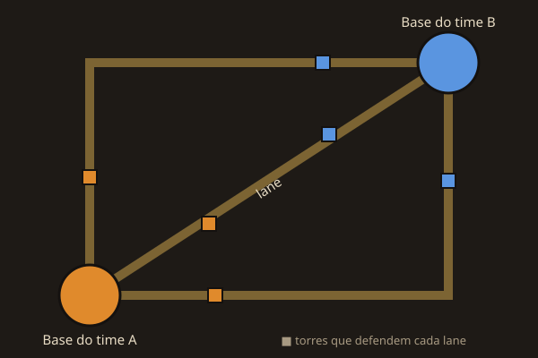

MOBA quer dizer *Multiplayer Online Battle Arena*, algo como "arena de batalha online". É um tipo de jogo em que **dois times se enfrentam num mapa fixo**, e cada time tenta destruir a base do outro. Dota 2 e League of Legends são os MOBAs mais famosos. Deadlock pega essa ideia e mistura com um jogo de tiro.

## A ideia em uma frase

Cada time tem uma **base**. Da base saem **lanes**, os caminhos que levam até a base inimiga. Ao longo das lanes ficam **torres** que defendem o caminho, e por elas marcham **tropas** controladas pelo computador, que lutam sozinhas contra as tropas do outro time. Para ganhar, é preciso abrir caminho por uma lane até chegar ao coração da base adversária.

## O que torna um MOBA diferente

- **Cada partida começa do zero.** Todo mundo começa fraco e fica mais forte durante o jogo. Nada que você ganha numa partida passa para a próxima: não existe personagem de nível alto nem item guardado de outras partidas.
- **Você controla um só personagem.** Cada herói tem habilidades próprias, e o time precisa de heróis que se completem.
- **Ficar forte é parte do jogo.** Derrotando tropas, monstros e heróis inimigos, você ganha uma moeda e compra itens que te deixam mais forte. Quem fica forte mais rápido tem vantagem.
- **Ganha o time, não o jogador.** Derrotar muitos inimigos ajuda, mas o que vence a partida é derrubar as estruturas do outro time. Um time que joga junto costuma ganhar de um time de jogadores bons que jogam cada um por si.

## E em Deadlock?

Deadlock segue essa ideia, com algumas diferenças importantes:

| | MOBA tradicional | Deadlock |
| --- | --- | --- |
| Câmera | Vista de cima | Terceira pessoa, atrás do herói |
| Ataque | Clicar no alvo | Mirar e atirar de verdade |
| Times | 5 contra 5 | 6 contra 6 |
| Moeda | Ouro | Souls |
| Movimento | Andar | Andar, pular, deslizar, dar dash e usar ziplines |
| Objetivo final | A estrutura no centro da base | O **Patron** inimigo |

O mapa é uma **Nova York mágica**, com **três lanes**: York, Broadway e Park. Você vai conhecer cada uma na seção *Mapa e macro*.

## Os dois lados: Hidden King e Archmother

Cada time defende um **Patron**, uma entidade antiga que fica no fundo da base:

- **The Hidden King**, uma figura sombria com chifres, que fica numa fábrica.
- **The Archmother**, que usa uma máscara quebrada parecida com a da Estátua da Liberdade e fica num museu.

Na história do jogo, os Patrons são deuses de outro plano, e os seguidores de cada um convocam os heróis para um ritual: **destruir o Patron do outro lado**. Na prática, é isso que vence a partida. O caminho até lá, passando pelas torres de cada lane, é o assunto do capítulo *Como se ganha*.
