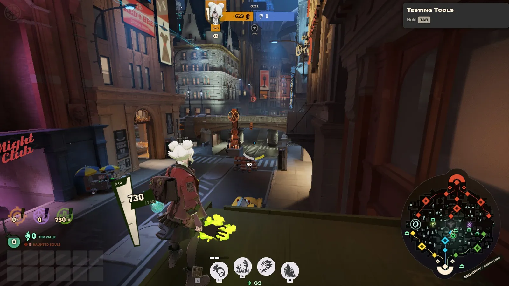
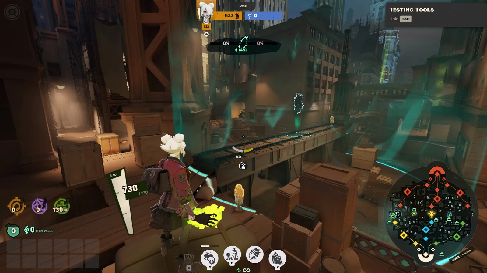
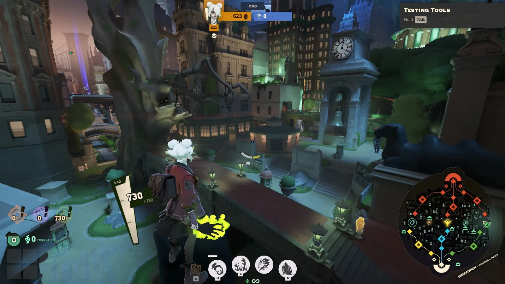
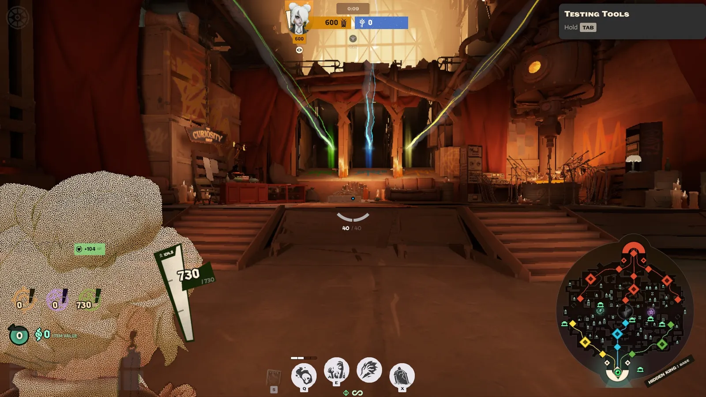
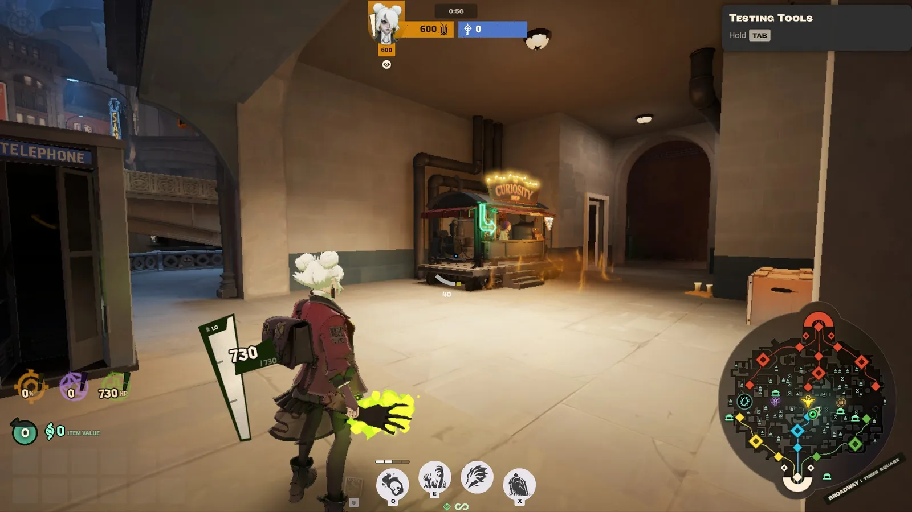
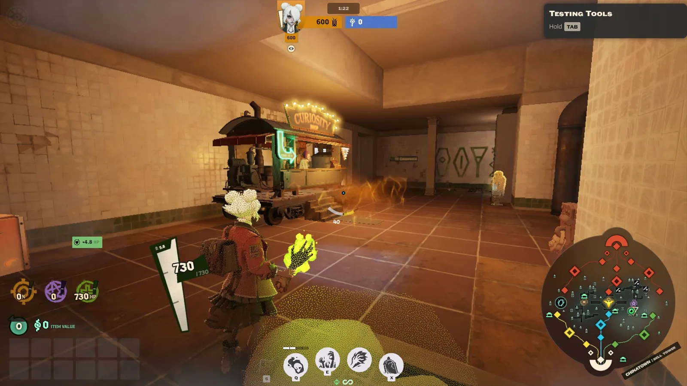
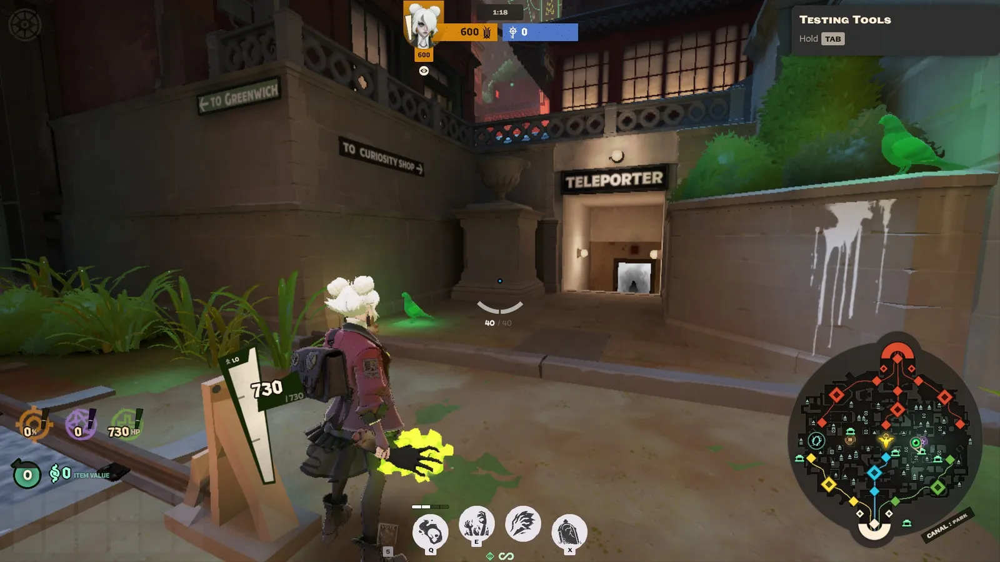

import { Image } from 'astro:assets';
import minimapa from './imagens/minimapa.webp';

Deadlock se passa numa **Nova York mágica dos anos 1920**, e o mapa é a cidade inteira: avenidas, prédios, telhados, becos e túneis. No começo parece um labirinto, mas a ideia é simples: **três avenidas ligando as duas bases**, com bairros entre elas.

## Lendo o minimapa

<Image src={minimapa} class="estreita" alt="O minimapa: a base do jogador embaixo, a base inimiga em cima, e as três lanes ligando as duas, em amarelo à esquerda, azul no meio e verde à direita" />

- **A sua base fica sempre embaixo** e a base inimiga sempre **em cima**. O minimapa gira conforme o seu time, então a lane que fica à esquerda para você fica à direita para o inimigo.
- **As três linhas** que ligam as bases são as **lanes**. Do lado do seu time, cada uma tem a sua cor. Do lado inimigo, tudo fica **vermelho**.
- **Os losangos** são as estruturas que você viu em *Como se ganha*: os pequenos são as Guardians e as Base Guardians, os grandes são os Walkers.
- **No centro** fica o ícone do **Mid-Boss**.
- **No canto de baixo**, uma plaquinha diz **onde você está**, sempre no formato *lugar : ponto*. Nesta imagem, "Hidden King : Base".

## As três lanes

As lanes são as avenidas por onde as tropas andam, de uma base até a outra. Cada uma tem um **nome**, uma **cor** e passa por três lugares conhecidos:

| Lane | Cor | Por onde passa |
| --- | --- | --- |
| **York** | Amarela | Bolsa de Valores, Fábricas Old Fairfax e o porto do Píer 16 |
| **Broadway** | Azul | Uptown, Times Square e Downtown |
| **Greenwich** | Verde | Universidade Umbria, Central Park e Brownstones |

As cores aparecem no minimapa e nas ziplines, e os nomes aparecem nos pings. Quando alguém do time escreve "York", já sabe de qual lane está falando.

### Broadway, a do meio

**Broadway** é a lane do **meio**. É a mais curta e o caminho mais direto até a base inimiga, por isso é considerada a mais importante. Embaixo dela, no esgoto bem abaixo da **Times Square**, fica o fosso do **Mid-Boss** (que você conheceu em *Eventos da partida*).

*Broadway vista de um telhado, em Downtown. A avenida passa embaixo do viaduto e segue em direção à Times Square. Repare na plaquinha do minimapa: "Broadway : Downtown".*

### York e Greenwich, as laterais

**York** e **Greenwich** ficam nas laterais. Para o time do **Hidden King**, York fica à esquerda e Greenwich à direita. Para o time da **Archmother**, é o contrário. A **Soul Urn** e o **Unstable Rift** aparecem sempre numa dessas duas.

*As docas de York, perto do Píer 16. Essa ponte é um dos lugares onde aparece o Unstable Rift: repare no contador de 1.482 souls no topo da tela.*

*O Central Park, em Greenwich. A árvore enorme à esquerda é a Hangman's Elm, que tem uns 300 anos.*

## Os distritos entre as lanes

Entre uma lane e outra ficam os **distritos**, cheios de becos, prédios e monstros da jungle. São quatro:

- **Theater**, o bairro dos teatros.
- **Plaza**, onde fica a **Sunken Plaza**, uma praça afundada no subsolo.
- **Chinatown**, o mais movimentado, onde fica a **Bell Tower**, uma torre com souls no alto.
- **Haunted Lot**, um terreno assombrado cheio de cogumelos.

Theater e Plaza ficam do lado da Archmother, e Chinatown e Haunted Lot do lado do Hidden King. Mas os dois times podem entrar em todos.

É nos distritos que fica a **jungle**, com os monstros e as caixas que dão souls fora da lane (veja *Jungle e caixas*). A Sunken Plaza e a Bell Tower dão muitas souls, mas são arriscadas. Elas ficam para *Lugares de risco e recompensa*.

## As bases

Cada time tem a sua base no fundo do mapa:

- A do **Hidden King** é uma **fábrica velha** cheia de alto-falantes e microfones.
- A da **Archmother** é um **museu** de colunas e mármore.

No fundo de cada base fica a **sala de spawn**, onde você começa a partida e renasce depois de morrer. Lá dentro:

- **Você se cura rápido.** Voltar para a base com pouca vida é uma boa ideia.
- **Tem uma loja**, que você pode usar de qualquer ponto da sala.
- **Tem torres de defesa** que atacam qualquer inimigo que entre.

Entre a sala de spawn e as lanes ficam as estruturas que você viu em *Como se ganha*: as Shrines, o Patron e as Base Guardians na saída de cada lane.

*A sala de spawn do Hidden King. A loja fica à esquerda, e as três ziplines saem pelo fundo, cada uma na cor da sua lane.*

## Onde comprar itens

Você não precisa voltar para a base toda vez que quiser comprar alguma coisa. O mapa tem três tipos de loja:

| Loja | Onde fica | Quem pode usar |
| --- | --- | --- |
| **Loja da base** | Na sala de spawn | Só o seu time |
| **Lojas das lanes** | Uma ao lado de cada Guardian | Só o time daquele lado. Fecha para sempre quando a Guardian cai |
| **Lojas secretas** | No subterrâneo, entre Broadway e as lanes laterais | Os dois times |

Na prática: no começo, compre na loja da sua lane, que fica pertinho. Depois que a sua Guardian cair, use a loja secreta ou volte para a base.

*A loja da lane em Broadway, pertinho da Guardian. Todas as lojas têm essa cara: uma carrocinha com a placa "Curiosity".*

*Uma loja secreta, num túnel de metrô embaixo de Chinatown.*

Perto das lojas secretas também ficam os **teleportes**, cabines que levam você para o outro lado do mapa. Placas na parede mostram o caminho:

Você vai ver como eles funcionam em *Como se locomover*.

## Em cima e embaixo

O mapa não é só o chão. Dá para subir nos **telhados** e nos andares de cima por **cordas** e descer para **túneis** no subsolo. Cada lane também tem uma **zipline** que passa por cima dela, de uma base até a outra. Tudo isso aparece em *Como se locomover*.

## Para aprender o mapa

O jeito mais fácil de conhecer a cidade é o modo **Explore NYC** (veja *Modos de jogo*): você anda pelo mapa sem inimigos e sem pressa. Tente ir de uma base até a outra por cada lane e entrar em cada distrito pelo menos uma vez.
