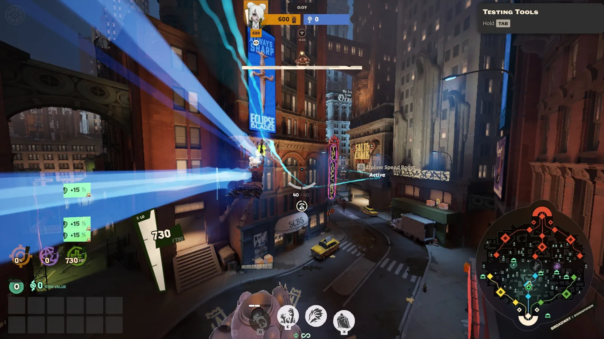
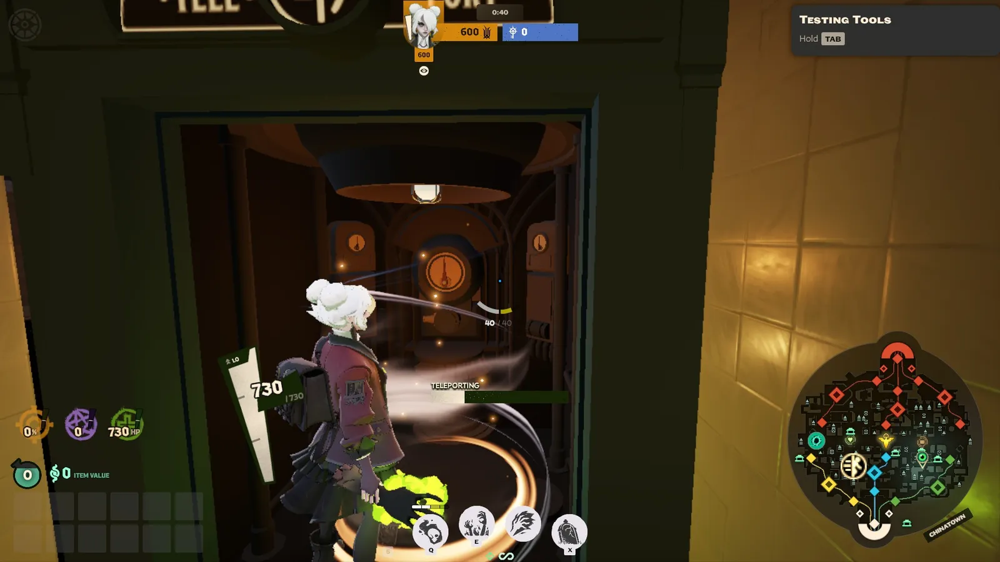
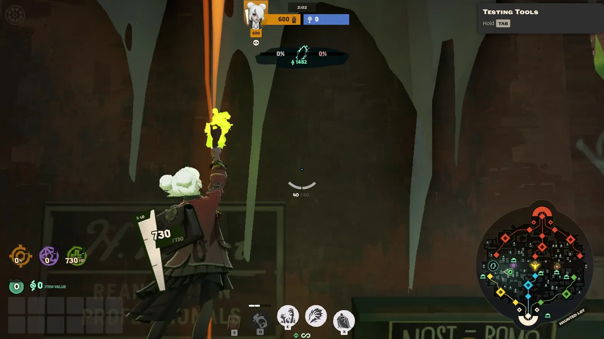
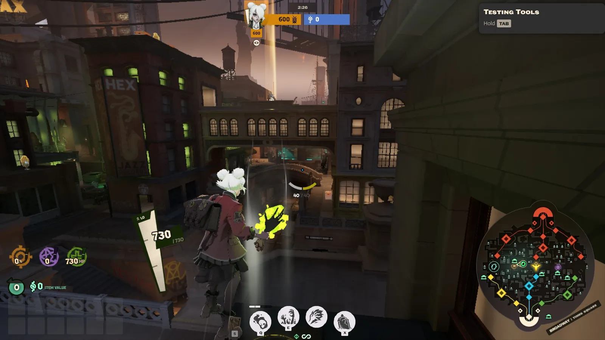
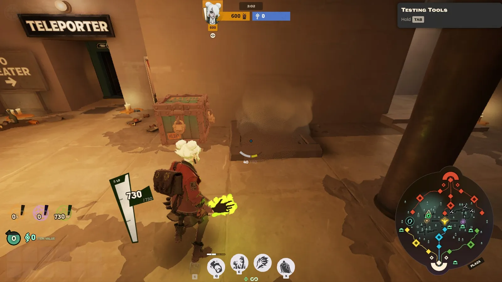

O mapa é grande, e andar a pé de uma ponta à outra demora. Saber usar os atalhos da cidade faz você chegar antes nas lutas, voltar mais rápido para a lane depois de morrer e fugir quando a coisa aperta.

## Ziplines

As **ziplines** são cabos que passam por cima de cada lane, da sua base até a base inimiga. Cada lane tem a zipline do seu time, na cor da lane. Na sala de spawn, você vê as três saindo pelo fundo (veja a imagem da base em *O mapa*).

*Na zipline de Broadway, com o boost ligado: repare no aviso "Zipline Speed Boost Active".*

### Como usar

- **Para subir:** pule (<kbd>Espaço</kbd>) embaixo do cabo quando aparecer o aviso de que dá para se conectar.
- **Para descer:** aperte <kbd>Ctrl</kbd>. Você cai mantendo o embalo por uns instantes.
- **Para acelerar:** aperte <kbd>F</kbd> enquanto está na zipline. É a mesma tecla do parry, mas na zipline ela liga o **boost**: 80% mais velocidade por 32 segundos. O boost libera aos **6 minutos** de partida e depois leva 6 minutos para recarregar.

### Trocar de lane

Cada zipline leva só para a sua lane. Para ir a outra lane:

- **Antes da partida começar**, você pode pedir para um aliado **trocar de lane** com você.
- **Depois que a partida começou**, desça da sua zipline e vá até a zipline da lane que você quer.

Subir na zipline também **recarrega** o seu pulo duplo e o dash no ar, o que ajuda quando você desce dela no meio de uma luta.

### Até onde ela vai

A zipline só leva você **até onde as suas tropas chegaram** naquela lane. Se a sua wave está perto da torre inimiga, a zipline vai longe. Se o inimigo empurrou a lane até a sua base, ela vai pouco.

Quando o seu time derruba as **Base Guardians** de uma lane, a zipline dela fica **mais rápida para sempre**, como se estivesse sempre com o boost (veja *Como se ganha*).

### Cuidado: dá para ser derrubado

Se um **herói inimigo** acertar você enquanto está na zipline, você **cai**, perde um pedaço da vida e fica **atordoado** por 2,5 segundos depois de chegar no chão. Cair atordoado no meio dos inimigos costuma ser fatal.

Depois de **3 segundos** no cabo, aparece um brilho azul em volta de você: aí você não cai mais, mas leva **mais dano** enquanto estiver lá em cima.

Na prática:

- **Use a zipline para ir para a lane, não para chegar numa luta.** Desça antes, num lugar seguro, e chegue a pé.
- **Olhe o minimapa** antes de subir. Se tem inimigo perto do caminho, ele pode te derrubar.
- **Tropas e torres não derrubam você.** Só heróis.

## Teleportes

O mapa tem **dois pares de teleportes**, cabines que levam você para o **outro lado do mapa**. Eles ficam perto das **lojas secretas**, nos túneis entre Broadway e as lanes laterais, e placas na parede mostram o caminho.

Para usar, entre na cabine e **espere 4 segundos**. Do outro lado, você ganha um pouco de **velocidade** por alguns segundos.

Esses 4 segundos são o ponto fraco: quem está fugindo pelo teleporte pode ser alcançado antes de sumir. E quem está carregando a **Soul Urn** não pode usar teleporte nem zipline.

*Dentro da cabine, a barra "Teleporting" mostra quanto falta para sumir.*

## Cordas

Muitos prédios têm **cordas** que levam até os **telhados** e andares de cima. Para subir, pule (<kbd>Espaço</kbd>) na corda.

Os telhados são ótimos para atirar de cima e para surpreender quem está na rua. Mas atenção: **se você levou dano de um herói nos últimos segundos, sobe bem mais devagar**, e um melee na corda deixa você quase parado. Subir uma corda fugindo de alguém que está atirando em você nem sempre é boa ideia.

## Air vents

Os **air vents** (ou *jump pads*) são saídas de ar que **lançam você** pelo ar numa direção. São um jeito rápido de atravessar um trecho do mapa ou de pular de um telhado para outro.

*As linhas brancas mostram o vento do air vent. É só passar por cima.*

Durante o voo, dá para **mudar um pouco a direção** olhando e andando para o lado.

## Steam vents

Os **steam vents** são saídas de vapor perto das lojas secretas, dos acampamentos da jungle e do Mid-Boss. Enquanto você fica parado no vapor:

- **Os inimigos não te veem.** O seu herói fica pontilhado, meio transparente.
- **Você se cura** um pouquinho por segundo.
- **Habilidades que precisam mirar num herói** não pegam você.

*Um steam vent na Plaza, do lado de um teleporte. A heroína está pontilhada porque está escondida no vapor.*

O esconderijo acaba se você **levar dano**, **atacar um inimigo** ou se um **herói inimigo entrar no mesmo vapor**. Os seus aliados continuam vendo você.

Use os steam vents para **se curar escondido** depois de uma luta, para **emboscar** quem passar perto ou para **despistar** quem está te perseguindo.

## Resumo

| Atalho | Para que serve | Cuidado com |
| --- | --- | --- |
| **Zipline** | Ir e voltar da lane rápido | Heróis inimigos te derrubam |
| **Teleporte** | Atravessar o mapa | Os 4 segundos de espera |
| **Corda** | Subir nos telhados | Sobe devagar se estiver levando dano |
| **Air vent** | Atravessar um trecho rápido | Você chega onde ele mandar |
| **Steam vent** | Se esconder e se curar | Some se levar dano ou atacar |

Além desses atalhos, o próprio herói tem jeitos de andar mais rápido: correr, deslizar, pular e dar dash. Isso fica para *Movimentação básica*.
