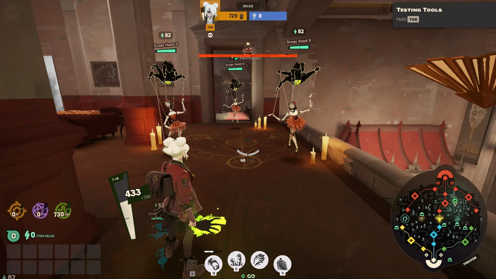
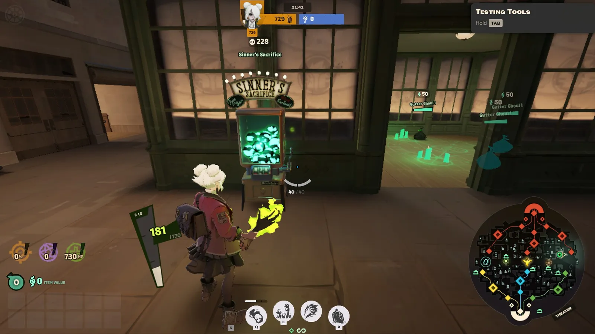

import Interface from '../../../components/Interface.astro';

Quase tudo que fica **entre as lanes** dá alguma coisa: monstros, caixas, máquinas e estátuas. Isso é a **jungle**. Ela é a segunda maior fonte de souls do jogo, depois das tropas, e é ali que você consegue souls extras sem precisar brigar com o time inimigo.

Lembre que as souls da jungle chegam como **Haunted Souls**, aquelas em vermelho que ainda podem cair se você morrer (veja *Souls: dinheiro e nível*). Farmar a jungle e morrer logo depois é jogar souls no chão para o inimigo.

## Os Haunts: os monstros da jungle

Os monstros da jungle se chamam **Haunts** e ficam em **acampamentos**, em grupos. São de três tamanhos:

| Tamanho | Aparece aos | Volta depois de | Souls por monstro |
| --- | --- | --- | --- |
| **Pequeno** | 2 minutos | 1 minuto e meio | 41 |
| **Médio** | 5 minutos | quase 5 minutos | 68 |
| **Grande** | 8 minutos | 5 minutos e meio | 181 |

O valor das souls e a vida dos monstros **crescem com o tempo de partida**. O tempo para voltar começa a contar quando o **último** monstro do acampamento morre.

*Um acampamento no Theater. Em cima de cada monstro aparecem o **nome**, a **vida** e **quantas souls** ele dá. O número romano no nome mostra o tamanho: **I** é pequeno, **II** é médio e **III** é grande.*

Cada lugar do mapa tem os seus monstros, combinando com o bairro:

- **York:** sacos de lixo assombrados e barris que explodem.
- **Broadway:** criaturas de laboratório, com pedaços que rastejam sozinhos.
- **Greenwich:** monstros feitos de livros, da universidade.
- **Theater:** ajudantes de palco assombrados.
- **Chinatown:** espíritos de festival e potes de caranguejo.
- **Haunted Lot:** cogumelos demoníacos.
- **Plaza:** criaturas do subsolo.

### Como farmar

- **Os monstros ficam parados até você chegar perto.** De longe, os tiros não fazem efeito.
- **Mire no olho.** Tiro no olho dá dano crítico, como tiro na cabeça.
- **Cuidado com os ataques especiais** dos médios e grandes. Alguns ataques corpo a corpo deles dá para bloquear com o parry.
- **Os grandes aguentam bastante.** No começo, é melhor ficar nos pequenos e médios.
- **O minimapa mostra os acampamentos** com triângulos: sem risco é pequeno, com um risco é médio e com dois riscos é grande.

## Sinner's Sacrifice

Máquinas parecidas com caça-níqueis, espalhadas pelo mapa. Elas aparecem aos **8 minutos** e voltam 5 minutos depois de quebradas.

*Uma máquina no ponto do jackpot: repare que todas as lâmpadas em cima da placa estão acesas. É a hora de bater.*

- **Só quebram com melee.** Tiro não faz nada.
- **Cada golpe dá souls**, e o último golpe dá metade do prêmio de uma vez. O prêmio começa em **310 souls**.
- **Cada golpe também machuca você:** a máquina devolve **80 de dano** a cada golpe. Com melee pesado, você precisa de 4 golpes; com melee leve, de 8. Ou seja, quebrar uma máquina custa de 320 a 640 de vida.

### O jackpot

Perto do fim, as luzes da máquina começam a acender da esquerda para a direita. Se você bater **no momento em que todas estiverem acesas**, ganha um **jackpot**: além das souls, **bônus permanentes** (1 com melee leve, 4 com melee pesado). Nessa hora, a máquina não devolve dano. Errou o tempo? Fica só com as souls.

Em **Chinatown**, bater nas máquinas toca um **sino** que todo mundo ouve. Os inimigos ficam sabendo que tem alguém ali.

## Caixas

O mapa está cheio de **caixas** (são mais de 500). Elas aparecem aos **3 minutos** e voltam uns 3 minutos depois de quebradas.

- **Caixas comuns** quebram com qualquer coisa: tiro, melee, habilidade ou até passando por cima com dash ou deslizando. Às vezes dão souls, às vezes não.
- **Tough Crates** são maiores, verdes, com cantos de metal, cadeados e a palavra **HEAVY**. **Só quebram com melee pesado**, mas sempre dão souls, o dobro de uma caixa comum.

<Interface tela="steam-vent" destaque="tough-crate" legenda="Uma Tough Crate: só abre com melee pesado" />

Cada caixa dá poucas souls, mas elas estão no caminho. Quebre as que encontrar enquanto anda pelo mapa.

## Estátuas douradas

Pequenas **estátuas douradas** num pedestal, espalhadas pelo mapa. Elas quebram como as caixas comuns.

<Interface tela="loja-secreta" destaque="estatua" legenda="Uma estátua dourada, no túnel da loja secreta de Chinatown" />

Metade das vezes, a estátua solta um **livrinho** com um **bônus permanente**: um pouco mais de vida, dano de arma, velocidade de tiro, spirit power, resistência, velocidade ou alcance das habilidades. Cada bônus é pequeno, mas eles **somam** e duram a partida inteira. Depois dos **10 minutos** os bônus ficam maiores, e depois dos **30**, maiores ainda.

As estátuas aparecem aos **3 minutos** e voltam 3 minutos depois de quebradas. Lembre de **pegar o livrinho**: se ninguém pegar, a estátua demora mais para voltar.

## Healing Bats

Pela cidade voam pequenos **morcegos verdes brilhantes**, os **Healing Bats**. Pegar um **cura 10% da sua vida**, o que pode salvar você depois de uma luta, longe da base.

<Interface tela="morcego" destaque="morcego" legenda="Um Healing Bat voando num beco de Greenwich" />

## Quando ir para a jungle

No começo, a jungle é um **extra**, não o principal. O seu lugar é a lane. Algumas regras:

- **Empurre a wave antes de sair.** Mate as tropas inimigas e depois vá farmar. Assim a lane não fica perdida enquanto você está fora.
- **Fique perto da sua lane.** Farme os acampamentos e caixas ao lado dela e volte para a próxima wave.
- **Avise o time** com um ping. Se a dupla inimiga sumir, o seu parceiro de lane precisa saber onde você está.
- **Olhe o minimapa.** Farmar sozinho com inimigos por perto é como os jogadores são pegos.
- **Com pouca vida, procure um Healing Bat** antes de voltar para a lane.
- **Gaste as souls** quando voltar para a base. Haunted Souls guardadas são souls em risco.

No meio da partida, a jungle fica mais importante: os acampamentos grandes já apareceram, e quem não está lutando nem empurrando uma lane deve estar farmando. Você vai ver como dividir o tempo entre lane, jungle e lutas em *Waves, rotações e ganks*.
