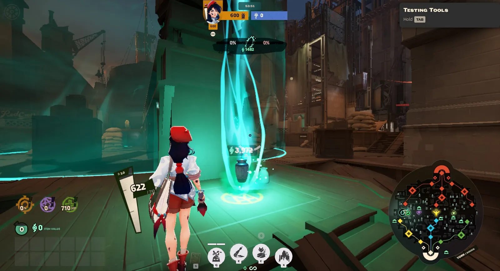
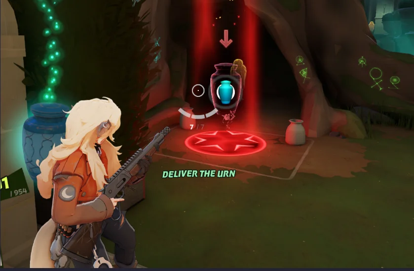
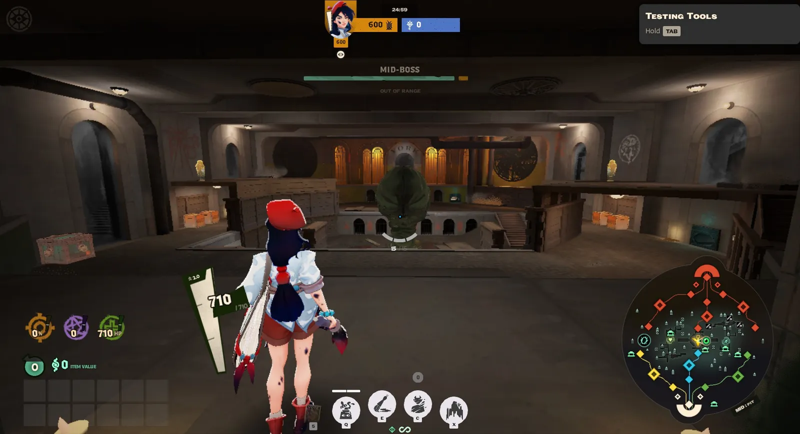
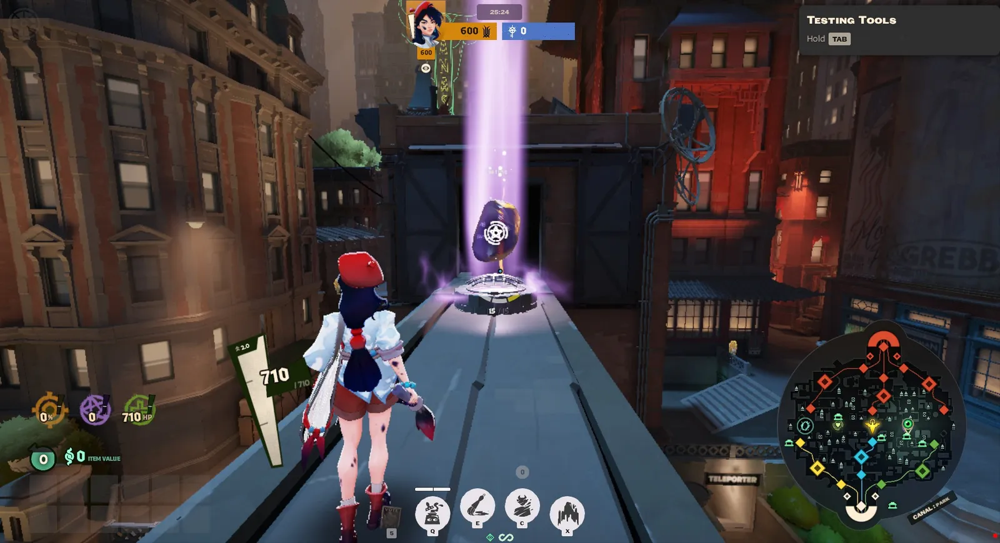

Além das estruturas de cada time, o mapa tem **objetivos neutros**: coisas que não são de ninguém e ficam para quem chegar primeiro. Eles dão prêmios grandes, então os dois times costumam brigar por eles. Você já viu quando cada um aparece em *Eventos da partida*. Aqui está como cada um funciona.

## Soul Urn

A **Soul Urn** é uma urna que precisa ser **levada** de um ponto do mapa até outro. Quem entrega ganha souls e bônus permanentes.

### Onde e quando

- Aparece pela primeira vez aos **10 minutos** e depois a cada **5 minutos**.
- Aparece perto da ponte de uma das **lanes laterais**, alternando: a primeira sempre em **York**, a seguinte em **Greenwich**, e assim por diante.
- Ela desce do céu num feixe de luz e leva uns **12 segundos** para pousar. Só dá para pegar depois que ela pousa.

*A urna pousada, esperando alguém pegar. Imagem: [Mobalytics](https://mobalytics.gg/deadlock/guides/soul-urn).*

### Como levar

Para pegar a urna, dê um **melee** nela. A partir daí, você é o **carregador**:

- Você fica **mais rápido**, ganha **stamina extra** e **não pode ser deixado lento**.
- Você **não pode** usar zipline, teleporte, nem dar parry.
- Você **deixa a urna cair** se levar um **melee** de um inimigo, se for **atordoado** ou se **morrer**. A urna fica no chão, onde caiu, e qualquer um pode pegar.

O ponto de entrega fica **do outro lado do mapa**, marcado no chão com um círculo vermelho. Basta chegar nele para entregar.

*O ponto de entrega. Imagem: [Mobalytics](https://mobalytics.gg/deadlock/guides/soul-urn).*

**Não demore:** 45 segundos depois de pegar, a urna começa a **perder valor**, até não valer nada.

### O prêmio

- **Souls**, que começam em 250 e crescem bastante com o tempo de partida. Elas saem como orbes no ponto de entrega: o carregador fica com tudo, a não ser que um inimigo roube os orbes com um tiro, o **deny** (veja *Souls: dinheiro e nível*).
- **4 bônus permanentes**, sorteados entre os mesmos das estátuas douradas (vida, dano, velocidade de tiro, spirit power e outros).
- Se o seu time está **atrás**, o carregador ganha resistências e mais velocidade, e a entrega vale souls extras.

### Dicas

- **Leve com o time por perto.** O carregador sozinho é presa fácil: um melee e a urna cai.
- **Para roubar a urna do inimigo, use melee ou atordoamento.** Tiro não derruba.
- **Escolha o caminho.** Sem zipline, o carregador precisa ir a pé. Evite passar perto de onde os inimigos estão.

## Mid-Boss

O **Mid-Boss** é o maior monstro do mapa. Ele fica num fosso no **esgoto embaixo da Times Square**, bem no meio do mapa.

*O fosso do Mid-Boss. A barra de vida dele aparece no topo da tela. Repare também nas estátuas douradas e nas caixas nas laterais.*

### Como funciona

- Ele já está no fosso desde o começo da partida, mas **dorme até alguém entrar**.
- Tem **muita vida** (mais de 13.000) e fica mais forte com o tempo. Derrotá-lo exige o **time quase inteiro**.
- Quando chega na metade da vida, ele dá um **rugido**.
- Depois de derrotado, ele volta em **7 minutos**. Na segunda vez, em 6; da terceira em diante, em 5. O tempo até ele voltar aparece no topo da tela.

### O prêmio

- **3.000 souls** (mais com o tempo), divididas com o time.
- **2 bônus permanentes** para cada jogador.
- O **Rejuvenator**, o cristal que você viu em *Morte e respawn*: cada melee pesado nele dá uma carga para o time, até 3, e quem tem carga renasce no mesmo lugar ao morrer.

**Atenção:** as cargas do Rejuvenator ficam para **quem bater no cristal**, não para quem derrotou o Mid-Boss. O cristal leva uns segundos para descer, e um inimigo que chegar a tempo pode **roubar as cargas**. Depois de derrotar o Mid-Boss, cuide do cristal.

### Quando fazer

O Mid-Boss é a hora mais arriscada da partida: o seu time fica junto, gastando vida, num buraco. Se o inimigo chegar no meio, vocês lutam cansados. Por isso, o melhor momento é **logo depois de ganhar uma luta**, com vários inimigos mortos esperando para renascer.

## Unstable Rift

O **Unstable Rift** é um ponto para **capturar** numa ponte de uma das lanes laterais.

*O Rift numa ponte das docas de York. No topo da tela, o progresso de cada time e o prêmio em souls.*

- Aparece perto dos **11 minutos** e depois a cada **7 minutos**, mais ou menos. O jogo avisa antes, e o ponto abre uns 20 segundos depois.
- Para capturar, o seu time precisa ficar **sozinho** no ponto por uns **12 segundos**. Com inimigos dentro, ninguém avança.
- Se ninguém conseguir em **60 segundos**, dá **empate**: o Rift solta souls no chão para quem pegar primeiro.

**O prêmio:** souls divididas com o time todo e **Rift Troopers**, tropas pretas e bem mais fortes, que passam a vir com as suas waves naquela lane. Elas ajudam a empurrar a lane até as torres inimigas.

Quem está **atrás** captura mais rápido, ganha mais tropas e recebe resistência extra perto do ponto. Para quem está perdendo, o Rift é uma boa chance de virar.

## Powerups

Os **powerups** são pedras brilhantes que aparecem em **pontes** e passarelas a cada **5 minutos**, a partir dos 5 minutos. Um **melee pesado** na pedra dá um bônus por **160 segundos**.

São quatro tipos, que você já viu em *Eventos da partida*: **spirit**, **arma**, **movimento** e **sobrevivência**. Quanto mais tarde, mais forte o bônus. Se você **morrer**, perde o bônus.

Pegue o powerup **antes de uma luta ou de um objetivo**, não quando estiver indo farmar sozinho: 160 segundos passam rápido.

## Vale a pena disputar?

Antes de ir para um objetivo neutro, faça três perguntas:

1. **Quantos somos?** Se três inimigos estão vivos e só dois aliados, é melhor esperar.
2. **Onde estão os inimigos?** Se o minimapa mostra que eles estão longe ou mortos, é a hora.
3. **O que estamos deixando para trás?** Ir para a Urn enquanto o inimigo derruba a sua torre pode ser uma troca ruim.

E sempre **avise o time com um ping** antes de ir. Objetivo neutro feito sozinho costuma terminar em morte.
