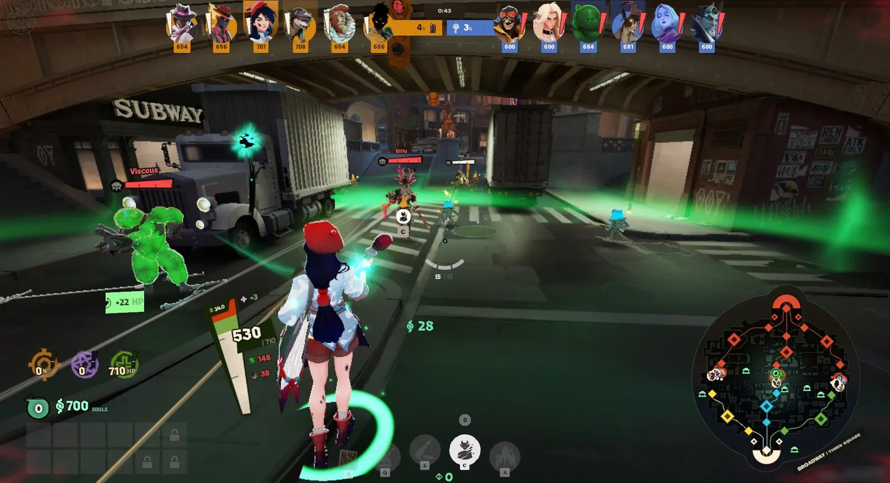

Atirar bem ganha lutas. Mas o que ganha partidas é estar **no lugar certo na hora certa**. Saber quando ficar na lane, quando sair para ajudar e o que fazer depois de uma luta é o que os jogadores chamam de **macro**. Este capítulo traz as ideias principais. Você não precisa dominar tudo de uma vez: elas vão fazendo sentido com as partidas.

## A wave decide onde é seguro

Lembra das tropas? Cada time solta uma **wave** a cada 30 segundos em cada lane, e as waves se encontram no meio do caminho. Quem tem mais tropas vivas vai **empurrando** a outra para trás.

*As primeiras waves se encontrando em Broadway, aos 43 segundos de partida. As tropas trocam tiros no meio da rua enquanto os heróis farmam e brigam em volta.*

Onde a wave está muda tudo naquela lane:

- **Perto da torre inimiga**, ela ameaça a torre, e o inimigo precisa defender.
- **Perto da sua torre**, ela ameaça você, e você fica preso defendendo.
- **A sua zipline só vai até onde as suas tropas chegaram** (veja *Como se locomover*). Wave empurrada é zipline longa.
- **Lembre da proteção contra backdoor**: as estruturas só caem com as suas tropas por perto (veja *Como se ganha*).

## Empurrar ou segurar

Você controla para onde a wave vai pelo jeito como mata as tropas.

### Empurrar

**Matar as tropas inimigas rápido**, com tiros e habilidades, faz a sua wave avançar até a torre inimiga.

- **A vantagem:** a torre inimiga fica sob ataque, o inimigo precisa ir defender e você ganha **tempo livre** para farmar a jungle, pegar um objetivo ou ajudar outra lane.
- **O risco:** você fica longe da sua torre e perto dos inimigos. É o momento em que um gank pega você.

### Segurar

**Matar só o necessário** (pegando as souls de cada tropa, sem destruir a wave toda) deixa a wave parada perto da sua torre.

- **A vantagem:** você fica num lugar seguro, e o inimigo precisa se aproximar da sua torre para farmar.
- **Quando usar:** quando a dupla inimiga está mais forte que a sua, ou quando você está sozinho na lane.

**Regra simples para começar:** se você vai sair da lane, **empurre antes**. Se vai ficar e está mais fraco, **deixe a wave vir até você**.

## Rotações: sair da lane para ajudar

**Rotacionar** é sair da sua lane para ir a outro lugar: ajudar outra lane, pegar um objetivo ou se juntar ao time para uma luta.

Boas horas para rotacionar:

- **Logo depois de empurrar a wave.** A próxima wave leva 30 segundos para chegar, e a sua lane não fica perdida.
- **Quando um objetivo vai aparecer**: a Urn, o Rift, um powerup (veja *Eventos da partida*).
- **Quando um aliado pede ajuda** com um ping, e você está perto.

E sempre:

- **Avise o time** de onde você vai. A roda de mensagens tem o **Headed To Lane...** só para isso (veja *Comunicação com o time*).
- **No começo da partida, volte para a próxima wave.** Deixar a lane sozinha por muito tempo dá souls e torre de graça para o inimigo.

## Ganks: pegar o inimigo de surpresa

**Gankar** é aparecer de surpresa numa lane para derrubar um inimigo, normalmente junto com o aliado que está nela. Os jogadores da lane estão ocupados com as tropas e o adversário da frente, e não esperam alguém chegando por trás.

Para gankar bem:

- **Chegue pela jungle, não pela lane.** Se você aparecer pela avenida, o inimigo vê você chegando.
- **Escolha o inimigo que avançou demais**, longe da torre dele.
- **Combine com o aliado da lane.** Um ping no inimigo avisa quem vocês vão pegar.
- **Use o que dá para usar:** um telhado, um steam vent, uma corda.

### Como não ser gankado

- **Olhe o minimapa a cada poucos segundos.** É o hábito mais importante do jogo.
- **Se um inimigo sumiu do minimapa, ele pode estar vindo.** Recue um pouco para perto da sua torre.
- **Avise o time** quando o adversário da sua lane sumir, no chat de voz, no chat de texto ou com um ping no minimapa. Esse aviso salva vidas.
- **Não avance demais** na lane sem saber onde estão os inimigos.

## Depois da luta

### Ganhou uma luta? Derrube alguma coisa

Matar inimigos é bom, mas **o que ganha a partida são as estruturas**. Depois de uma luta ganha, os inimigos mortos ficam um tempo esperando para renascer (veja *Morte e respawn*). Esse é o momento de transformar a vitória em vantagem:

- **Empurre a wave mais próxima** e ataque a torre junto com as tropas.
- **Faça o Mid-Boss** ou pegue a Urn, se estiverem disponíveis.
- **Não persiga** os últimos inimigos até a base deles. Morrer depois de ganhar a luta joga a vantagem fora.

### Perdeu uma luta? Recue

- **Volte para perto das suas torres** e deixe as tropas ajudarem.
- **Espere o time renascer** antes de lutar de novo.
- **Farme num lugar seguro** enquanto isso.

## Não fique todo mundo junto à toa

Quando várias pessoas do time estão perto de uma tropa que morre, **as souls são divididas** (veja *Souls: dinheiro e nível*). Por isso, no começo e no meio da partida, o time costuma ficar **espalhado**: cada um farmando a sua parte do mapa e se juntando para lutas e objetivos.

No **fim da partida** é o contrário: cada morte custa muito, e quem anda sozinho é pego. Aí o time anda **junto** (veja *As fases da partida*).

## O que fazer agora?

Quando estiver em dúvida, olhe o minimapa e o relógio e passe por esta lista:

| Situação | O que fazer |
| --- | --- |
| Tem uma wave chegando na sua lane | Pegue as souls dela |
| A wave está empurrada e não vem outra tão cedo | Farme a jungle por perto ou ajude outra lane |
| Um objetivo vai aparecer | Junte-se ao time e chegue antes |
| O seu time acabou de ganhar uma luta | Derrube uma torre ou faça o Mid-Boss |
| O seu time acabou de perder uma luta | Recue, defenda e farme seguro |
| Você está com pouca vida | Volte para a base ou procure um Healing Bat |
| Você tem souls sobrando | Compre itens |
