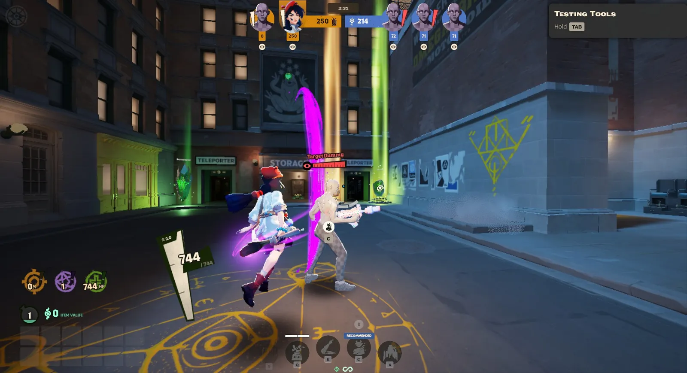

import Interface from '../../../components/Interface.astro';

Além da arma, todo herói tem um **ataque corpo a corpo**, o **melee**. E todo herói tem um jeito de se defender dele: o **parry**. Os dois são usados o tempo todo, para farmar, pegar objetivos e brigar.

## Melee leve e pesado

O melee usa a tecla <kbd>Q</kbd> (veja *Controles e interface*):

- **Toque** para o **melee leve**: sai na hora, com pouco dano.
- **Segure** para o **melee pesado**: o herói prepara o golpe por um instante e depois **avança** para a frente, com muito mais dano.

*Um melee pesado acertando o boneco de treino do Sandbox.*

O melee pesado tem detalhes úteis:

- **Não gasta stamina**, e o avanço ajuda a chegar mais longe ou a subir em beiradas.
- **Dá para carregar no ar**, pulando.
- Depois de usar, ele leva **1 segundo** para ficar pronto de novo (um pouco mais se você errar).

## Para que serve o melee

Muita coisa no jogo só funciona com melee, e algumas só com o **pesado**:

| Coisa | Melee que precisa |
| --- | --- |
| Tough Crates | Pesado |
| Powerups | Pesado |
| Cristal do Rejuvenator | Pesado |
| Bolsa de souls de quem morreu | Pesado |
| Sinner's Sacrifice | Leve ou pesado |
| Pegar a Soul Urn | Leve ou pesado |
| Derrubar a Urn de quem está carregando | Leve ou pesado |

E na luta:

- **Matar uma tropa com melee** dá todas as souls para você, sem orbe para o inimigo roubar (veja *Farmando tropas*).
- **Terminar um inimigo** com pouca vida e perto de você.
- **Recarregar sem parar de bater**: o melee pausa a recarga, e ela continua depois do golpe.

Cuidado: depois de um melee, o herói fica **um pouco mais lento** por um instante. Errar um melee pesado no meio dos inimigos pode custar caro.

## O parry

O **parry** (tecla <kbd>F</kbd>) bloqueia o melee do inimigo. Você aperta e, por **menos de um segundo**, qualquer melee que chegar é bloqueado.

<Interface tela="parry" aproximar={false} legenda="O parry: a heroína fica envolta num brilho azul enquanto ele está ativo" />

Logo depois de usar o parry, aparece ao lado da mira um **ícone vermelho** de punho, com um anel em volta. Enquanto o anel não se completa, o parry está recarregando:

<Interface tela="parry" destaque="recarga" legenda="O ícone do parry recarregando, ao lado da mira" />

### Quando dá certo

Se um inimigo der melee em você durante o parry:

- Ele **não causa dano**.
- Ele fica **atordoado por quase 3 segundos**, sem poder fazer nada.
- Ele leva **25% a mais de dano** de qualquer um enquanto isso.

Ou seja: um parry bem dado é uma chance enorme para você e o seu time acabarem com ele.

### Quando dá errado

Se você der parry e **ninguém** te atacar com melee, o parry fica **recarregando por 4,5 segundos**. Nesse tempo, você não tem como se defender do melee.

Por isso, **não aperte o parry à toa**. Muitos jogadores fingem que vão dar um melee pesado só para você gastar o parry, e aí atacam de verdade.

### O que dá para bloquear

- **Melee leve e pesado** de heróis. O pesado é o mais fácil de prever, porque o herói avisa: ele para e prepara o golpe.
- **O melee das Guardians**, quando você chega muito perto delas (veja *Como se ganha*).
- **O melee das tropas**.

O parry **não** bloqueia tiros nem a maioria das habilidades.

## Dicas

- **Fique de olho no herói que para e se prepara** na sua frente: é um melee pesado vindo. Esse é o momento do parry.
- **Não dê melee pesado em quem está te olhando de frente** e parado: ele pode estar esperando para dar parry.
- **Use o melee pesado para fugir** ou perseguir: o avanço não gasta stamina.
- **Treine no Sandbox** (veja *Modos de jogo*): os bonecos de treino ajudam a pegar o tempo do melee pesado.
