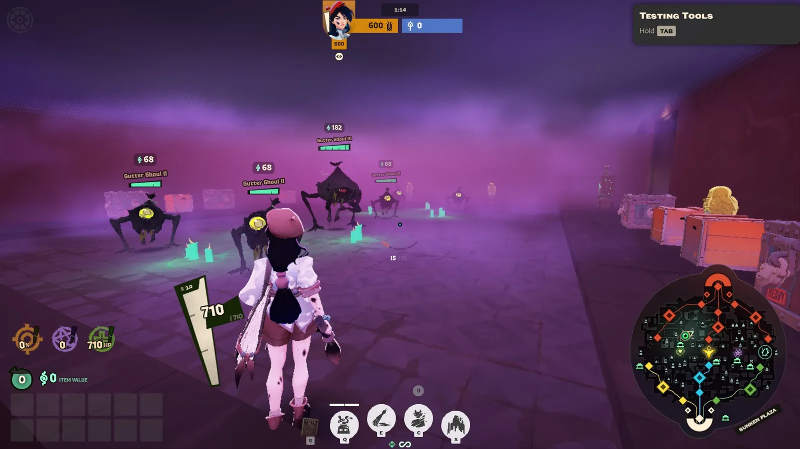
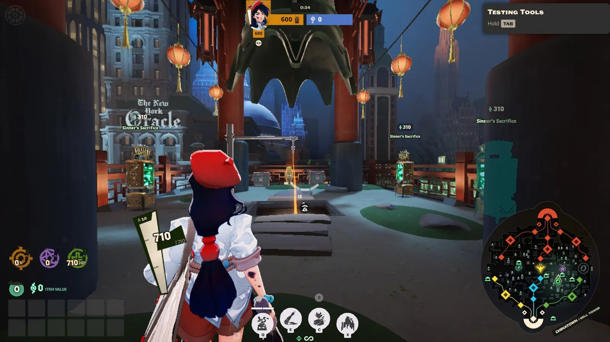

O mapa tem dois lugares que dão **muito mais souls** que a jungle comum, mas cobram caro por isso. Eles ficam nos distritos que você conheceu em *O mapa*: a **Sunken Plaza**, na Plaza, e a **Bell Tower**, em Chinatown. Para quem está começando, o melhor é conhecer os dois e ir com cuidado, de preferência com o time por perto.

## Sunken Plaza

Embaixo da praça principal da Plaza fica uma **praça afundada**, coberta por uma **névoa roxa**. Lá dentro tem um acampamento grande de monstros, caixas, estátuas douradas e máquinas do Sinner's Sacrifice.

*Dentro da Sunken Plaza: monstros, caixas e uma estátua dourada, tudo coberto pela névoa roxa.*

### O preço

A névoa muda as regras:

- **Você não ouve nada** do que acontece lá fora, e quem está fora não ouve você.
- **Ninguém vê através da névoa**, nem de dentro para fora, nem de fora para dentro.
- **A stamina vai acabando** aos poucos e **não volta** enquanto você está na névoa.

Sem stamina, você **não consegue pular nas paredes** para sair. Aí só resta sair pelos cantos onde ficam as máquinas do Sinner's Sacrifice ou pelos corredores subterrâneos ligados à praça.

Ou seja: se um inimigo entrar atrás de você, você não ouve ele chegando, não vê quem está esperando lá fora e pode ficar sem stamina para fugir.

### Como usar

- **Entre com a stamina cheia** e saiba por onde vai sair.
- **Vá quando os inimigos estiverem longe ou mortos**, por exemplo logo depois de uma luta ganha.
- **Farme rápido e saia.** Quanto mais tempo lá dentro, menos stamina para fugir.
- **Avise o time** antes de entrar: lá dentro, você não vai ouvir ninguém.

## Bell Tower

Em Chinatown fica a **Bell Tower**, uma torre tão alta que passa do limite normal do mapa. No alto, em volta de um **sino enorme**, ficam várias máquinas do **Sinner's Sacrifice**, caixas e estátuas douradas.

*O alto da Bell Tower: o sino no meio, três máquinas do Sinner's Sacrifice em volta e a corda laranja no centro, o único caminho para subir e descer.*

### O preço

- **Só existe um caminho**: a **corda** no meio da torre. Para subir e para descer.
- **Bater nas máquinas ou quebrar as caixas lá em cima toca o sino**, e o **mapa inteiro ouve**. Os dois times ficam sabendo que tem alguém na torre.

Então, quem está lá em cima fica preso: o inimigo sabe onde você está e só precisa esperar na corda.

### Como usar

- **Vá quando os inimigos próximos estiverem mortos** ou longe, empurrados para as suas lanes.
- **Lembre do jackpot** das máquinas (veja *Jungle e caixas*): com o time por perto, vale a pena caprichar.
- **Desça assim que terminar.** Depois do sino, alguém pode estar vindo.

## O Unstable Rift

O **Unstable Rift**, o ponto de captura nas pontes das lanes laterais, também é um lugar de risco e recompensa: prêmio grande, mas os dois times sabem quando e onde ele aparece. Ele está explicado em *Urn, Mid-Boss e buffs*.

## A regra geral

Lugares que dão muitas souls são lugares onde os inimigos **esperam encontrar alguém**. Antes de ir, faça as mesmas perguntas de qualquer objetivo neutro: quantos inimigos estão vivos, onde eles estão e o que você está deixando para trás.
